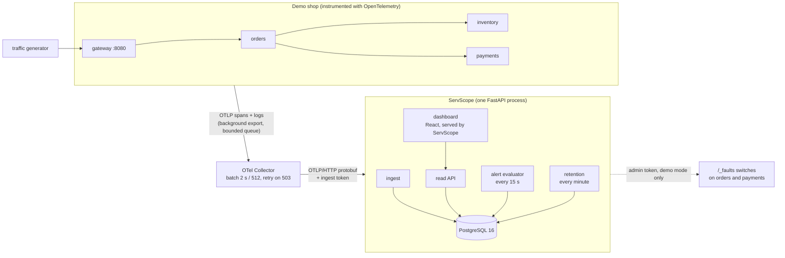
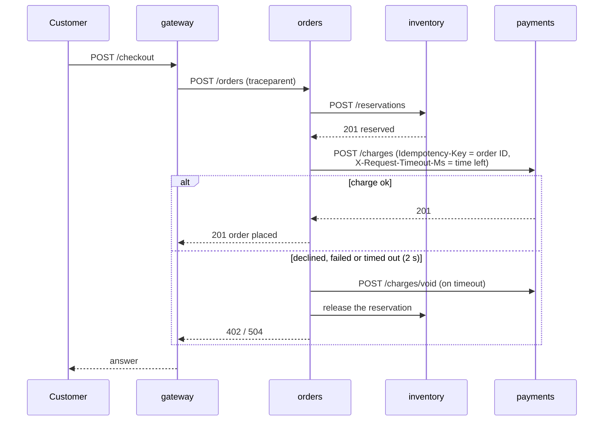
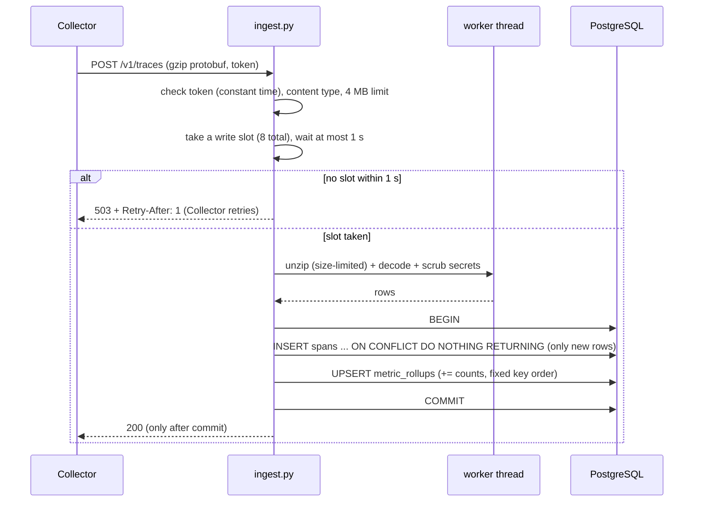
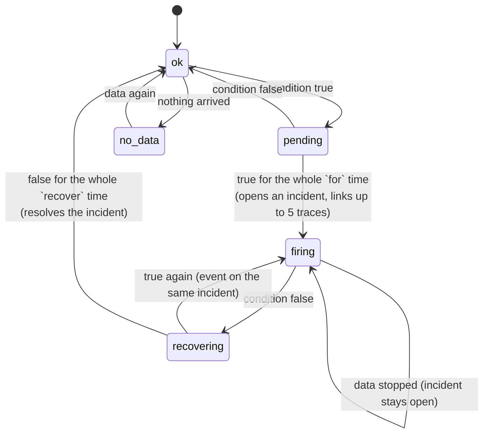
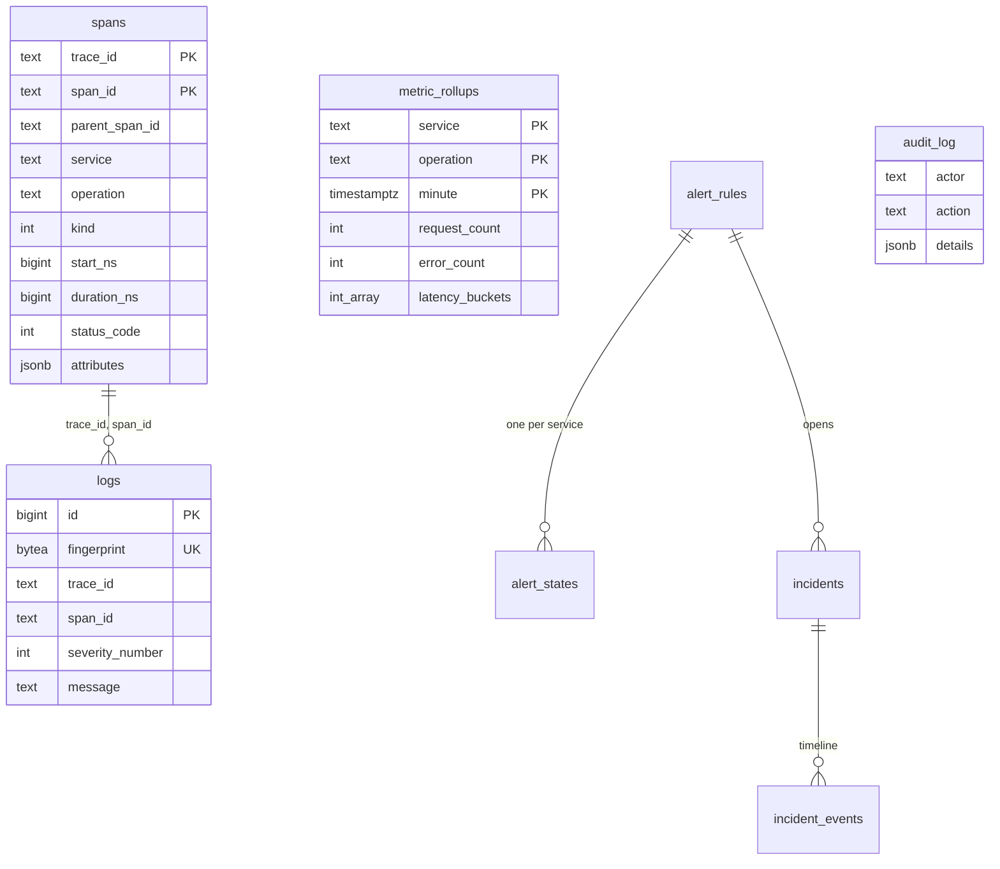

# Architecture

How ServScope is put together, in five diagrams. GitHub renders them (Mermaid). Each one
names the files where the behaviour lives.

## 1. The whole system

- The shop never waits for telemetry: if the Collector or ServScope is down, checkouts still
  work (drills D1, D2, D4 in [reliability.md](reliability.md)).
- ServScope stores everything in PostgreSQL. There is no separate metrics or search engine
  ([ADR 0001](decisions/0001-postgresql-for-everything.md)).
- Code: `src/demo_services/` (the shop and its OpenTelemetry setup), `deploy/collector.yaml`,
  `src/servscope/`.

## 2. One checkout, one trace

Nine spans per checkout: a server span in each service, a client span for each call, and the
work inside inventory and payments. Trace context crosses services only in the W3C
`traceparent` header. The deadline header and the void exist because Milestone 4 found a
double charge ([ADR 0006](decisions/0006-deadline-and-void.md)).

## 3. Ingest: from a batch to stored rows

- **Acknowledged means stored:** the 200 comes after the commit, so a crash mid-write means
  the Collector re-sends ([ADR 0002](decisions/0002-ack-after-commit-idempotent-ingest.md)).
- **Retries can't double-count:** `(trace_id, span_id)` is the key, and only rows that were
  actually inserted feed the per-minute metrics, in the same transaction
  ([ADR 0003](decisions/0003-rollups-at-ingest.md)).
- **Backpressure, not queues:** the slot is taken before any decoding, so refusing a flood
  costs nothing ([ADR 0004](decisions/0004-backpressure-with-503.md)).
- **SQLAlchemy Core, not the ORM, for the inserts:** about 5× the throughput on one core
  ([ADR 0007](decisions/0007-core-inserts.md), [performance.md](performance.md)).

## 4. Alerts: one state machine per rule and service

- `alerting.step` is a pure function, unit-tested transition by transition. The evaluator
  (`evaluator.py`) runs it every 15 s in one transaction behind a PostgreSQL advisory lock,
  and stores the state, so a restart resumes half-elapsed timers.
- Rules only look at data at least 30 s old, so spans still in transit don't look like
  silence ([ADR 0005](decisions/0005-alerts-on-settled-data.md)).
- At most one open incident per rule and service is enforced by a partial unique index, not
  only by code.

## 5. Data model

- `metric_rollups` holds one row per (service, operation, minute) with 12 fixed latency
  buckets (5 ms to 10 s). p50/p95/p99 are estimated from them, accurate to the bucket width.
- `app_settings` holds the retention days changed from the Settings screen.
- Retention deletes in batches of 5,000 rows every minute, so ingest never waits behind one
  huge delete. Open incidents are never deleted.
